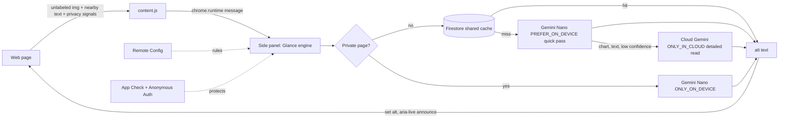

# Glance: image descriptions for screen readers, private by default

**Glance is a Chrome extension (plus a hosted web demo) that writes the missing descriptions for images on any website, so blind and low-vision people hear what an image shows instead of "image" or `IMG_2041.jpg`.**

It uses **Firebase AI Logic hybrid inference**. Gemini Nano on the user's own computer does the work by default. Cloud Gemini is used only when two things are true: the page is public, and the image is too complex for Nano (a chart, a screenshot, a notice full of text).

> Built for #BuildHybridAI 2026 · Platform: **Web / Chrome** · License: Apache 2.0

## The problem

- More than half of the top million home pages have images with no alt text ([WebAIM Million](https://webaim.org/projects/million/)). Missing alt text is one of the most common accessibility failures on the web.
- Screen reader users then hear nothing useful: a file name, "image", or silence.
- Cloud "describe this image" tools exist, but they ask blind users to upload **everything they see** to a server: their email, bank statements, medical portals, family photos. Blind users should not have to give up privacy to get access.

## Why hybrid is the right answer, not just a feature

| Situation | Where Glance runs | Why |
|---|---|---|
| Private page (mail, banking, health, personal photos, any page with a password field, any site you mark private) | **`ONLY_ON_DEVICE`** Gemini Nano | The image never leaves the computer. If Nano isn't available, Glance refuses to send the image anywhere and says so. |
| Public page, simple photo | **`PREFER_ON_DEVICE`** | Instant, free, works offline. Falls back to cloud on devices without Nano. |
| Public page, chart / screenshot / document / text in the image / low confidence | Nano quick pass → **`ONLY_IN_CLOUD`** detailed read | Charts need exact numbers and text needs exact transcription, so the stronger model is worth the cost. |
| Public image already described by anyone | **Firestore shared cache** | Zero model calls. Each image on the public web only needs describing once, for everyone. |

Each description shows its full **routing trace**: privacy decision, cache hit or miss, which model ran, latency, and why. Judges and users can see the hybrid logic working, not just read about it.

## Features

- Describes images automatically as you scroll (IntersectionObserver), including ones added later (MutationObserver).
- Writes the description into the page's real `alt` attribute, so it works with every screen reader (NVDA, JAWS, VoiceOver, ChromeVox) without any new tool to learn.
- **Alt+Shift+D** gives a detailed description of the focused or hovered image, read out through an ARIA live region.
- **Ask about this image:** follow-up questions in the side panel ("What does the small text at the bottom say?"), routed with the same privacy rules.
- Respects `alt=""`, `role="presentation"` and `aria-hidden` on small decorative images, and still describes large images a site mislabeled as decorative.
- Converts WebP/AVIF/GIF/SVG to downscaled JPEG before inference. Nano only accepts JPEG/PNG, so this keeps more images on the device.
- Descriptions in English, Spanish or Japanese.
- Optional visual captions with On device / Cloud / Shared badges, for sighted helpers, QA and demos.
- An impact counter: how many images were described, how many on device, in the cloud, from the shared cache, and how many were kept private.

## Firebase products used

| Product | Use |
|---|---|
| **Firebase AI Logic** (`firebase/ai`) | `getGenerativeModel` with `InferenceMode.PREFER_ON_DEVICE`, `ONLY_ON_DEVICE` and `ONLY_IN_CLOUD`. Multimodal image + text prompts. `response.inferenceSource` drives the trace. See [`src/core/engine.js`](src/core/engine.js). |
| **App Check** | Required by AI Logic. reCAPTCHA Enterprise on the hosted demo, a registered debug token in the extension. See [`src/core/firebase.js`](src/core/firebase.js). |
| **Firestore** | Shared cache of public-image descriptions (doc id = SHA-256 of URL + language, so no URLs are stored) and a "report wrong description" feedback queue. Locked down by [`firestore.rules`](firestore.rules). |
| **Authentication** | Anonymous auth (`firebase/auth/web-extension` inside the MV3 extension). Gates every Firestore read and write. |
| **Remote Config** | Live-tunable sensitive-site patterns, which image kinds escalate to the cloud, confidence threshold, cloud model names, cache on/off and image size. See [`src/core/defaults.js`](src/core/defaults.js). |
| **Hosting** | The web demo. |

## Architecture

The AI runs in the extension's **side panel**, a window context where Chrome exposes the Prompt API. The content script only finds images, collects privacy signals and writes results back.

## Run it

Requirements: Node 20+, Chrome 139+ desktop, and a Firebase project on the free Spark plan.

1. Firebase console: create a project and add a **Web app**. Enable **AI Logic** (Gemini Developer API), **Firestore**, **Authentication → Anonymous**, and **App Check** (register reCAPTCHA Enterprise for the web app and add a debug token).
2. `cp glance.config.example.js glance.config.js` and paste your web config, site key and debug token.
3. `npm install && npm test && npm run build`
4. **Extension:** go to `chrome://extensions`, turn on Developer mode, choose **Load unpacked** and select `dist/extension`. Press **Alt+Shift+G**.
5. **Web demo:** `npx firebase deploy --only hosting,firestore:rules`, or serve `dist/web` locally.
6. **On-device AI:** on supported hardware, click **Download Gemini Nano** in the panel. If needed, enable `chrome://flags/#prompt-api-for-gemini-nano-multimodal-input`. Without Nano, public pages still work through the cloud, and private pages are blocked on purpose.

## Testing instructions for judges

- **No install:** open the hosted demo, upload any image, and switch between *Private* and *Public* to see the routing trace change. Click **Describe every image on this page** for the sample article (a chart, a notice with text, and a photo-style scene).
- **Extension:** load `dist/extension` (or the release zip), open any news site or Wikipedia, and press **Alt+Shift+G**. Then open a page with a login form: the panel shows *Private*, and every badge says *On device*.
- With a screen reader on, Tab to an image and press **Alt+Shift+D**.

## Built during the contest period

Everything in this repository was written from scratch between Nov 11 and Nov 30, 2026: the hybrid engine, privacy classifier, content script, side panel, web demo, Firestore rules and tests. Third-party code: the Firebase JS SDK and esbuild (build only). AI coding assistants were used during development.

## Tests

`npm test` covers alt-text quality detection, decorative-image handling, privacy classification, the guarantee that private pages never route to the cloud, escalation rules and model-reply parsing.
